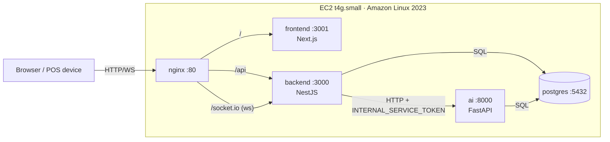

# Maminco Infra

Infrastructure and deployment for **Maminco**, a restaurant POS system. This
repository contains **no application code** — only Docker, nginx, Terraform,
CI templates and deployment documentation for the four Maminco services.

> Goal: a **low-cost, single-host AWS deployment** — one small EC2 instance
> running the whole stack via Docker Compose, with nginx on port 80. No ALB,
> no RDS, no NAT gateway. Cheap enough for a student project.

## Services

| Service            | Tech                              | Port (internal) | Notes |
| ------------------ | --------------------------------- | --------------- | ----- |
| `maminco-backend`  | NestJS 11 + Prisma 6 + socket.io  | 3000            | REST at `/api/*`, socket.io |
| `maminco-frontend` | Next.js 16 (App Router)           | 3001            | SSR + middleware → needs Node |
| `maminco-ai`       | FastAPI (uvicorn)                 | 8000            | ML/forecast service |
| `maminco-mobile`   | Expo / EAS                        | —               | Not containerized |
| `postgres`         | PostgreSQL 16 (Alpine)            | 5432            | Data volume |
| `nginx`            | nginx 1.27 (Alpine)               | **80** (public) | Reverse proxy + WS |

## Architecture (single host)



See [docs/ARCHITECTURE.md](docs/ARCHITECTURE.md) for the full diagram.

## Repository layout

```
maminco-infra/
├── docker-compose.yml        # the whole stack (postgres, backend, ai, frontend, nginx)
├── .env.example              # all shared env vars (copy to .env)
├── Makefile                  # up / down / logs / rebuild / seed / tf-up / deploy …
├── nginx/default.conf        # reverse proxy + websocket upgrade for socket.io
├── docker/                   # reference Dockerfiles for each app repo
│   ├── backend.Dockerfile
│   ├── ai.Dockerfile
│   └── frontend.Dockerfile
│   └── *.dockerignore        # copy into each app repo to shrink build context
├── deploy/
│   ├── ec2-setup.sh          # first-boot: docker, clone repos, .env, compose up
│   └── ec2-update.sh         # redeploy a single service
├── terraform/                # EC2 + SG + VPC (+ optional S3/CloudFront)
│   ├── main.tf  variables.tf  outputs.tf  user_data.sh
│   └── terraform.tfvars.example
├── ci/                       # workflow templates to copy into each app repo
│   ├── backend-ci.yml  frontend-ci.yml  ai-ci.yml
├── docs/
│   ├── ARCHITECTURE.md  DEPLOYMENT.md  DATA-MODEL.md  FLOWS.md
└── .github/workflows/infra-ci.yml
```

## Quick start (local, Docker)

```bash
cp .env.example .env          # edit secrets (JWT_SECRET, INTERNAL_SERVICE_TOKEN)
make up                       # or: docker compose up -d --build
make logs                     # tail logs
```

The app repos must be checked out **as siblings** of this one:

```
development/
├── maminco-infra/       <- you are here
├── maminco-backend/
├── maminco-frontend/
└── maminco-ai/
```

Compose builds each app with `context: ../maminco-<app>` and the Dockerfile
from `docker/` in this repo, so **the app repositories stay untouched**.

> **Build speed tip:** Docker sends the whole build context (including
> `node_modules`) unless a `.dockerignore` exists in the app repo. Copy the
> ready-made files from `docker/*.dockerignore` into each app repo to speed
> builds up dramatically.

Open <http://localhost>. The first admin user is created with
`POST /api/auth/register-first-admin` (only works while no users exist).

## Deploy to AWS (short version)

```bash
cd terraform
cp terraform.tfvars.example terraform.tfvars   # edit region, key_name, SSH CIDR
terraform init && terraform apply

# then, on the instance (SSH or SSM):
cd /opt/maminco/maminco-infra
cp .env.example .env && vi .env
make up
```

Full walkthrough, including rollback: [docs/DEPLOYMENT.md](docs/DEPLOYMENT.md).
Spanish onboarding: [ONBOARDING.md](ONBOARDING.md).

## Cost (ballpark, us-east-1, on-demand)

| Item | Cost |
| ---- | ---- |
| EC2 `t4g.small` | ~$12/mo (use `t3.micro` for free tier) |
| 20 GiB gp3 EBS | ~$1.6/mo |
| Elastic IP | free while attached |
| S3 + CloudFront (optional) | usage-based, off by default |
| **Total** | **~$14/mo** |

> Stop the instance when not in use (`aws ec2 stop-instances`) to save compute
> cost; the EBS volume and EIP persist.

## Environment variables (key ones)

| Variable | Used by | Notes |
| -------- | ------- | ----- |
| `POSTGRES_USER/PASSWORD/DB` | postgres | Compose builds the DB URLs from these |
| `JWT_SECRET` | backend | **required**, min 32 chars |
| `INTERNAL_SERVICE_TOKEN` | backend & ai | **must be identical** on both sides |
| `AI_INTERNAL_SERVICE_TOKEN` | ai | derived from `INTERNAL_SERVICE_TOKEN` in compose |
| `CORS_ORIGIN` | backend | public origin(s), comma-separated |
| `NEXT_PUBLIC_API_URL` / `NEXT_PUBLIC_SOCKET_URL` | frontend | **build args**; origin only, no `/api` |

Full reference with comments: [.env.example](.env.example).

## Conventions / invariants

- **Token invariant:** backend `INTERNAL_SERVICE_TOKEN` == ai `AI_INTERNAL_SERVICE_TOKEN`.
- **Frontend is not static:** middleware requires a Node server (`next start`).
  S3/CloudFront is optional and only for static assets/backups.
- **No committed Prisma migrations** yet → the backend container runs
  `prisma db push` (not `migrate deploy`) then the idempotent seed on boot.
- Each app lives in its **own git repository**; commit per repository.
