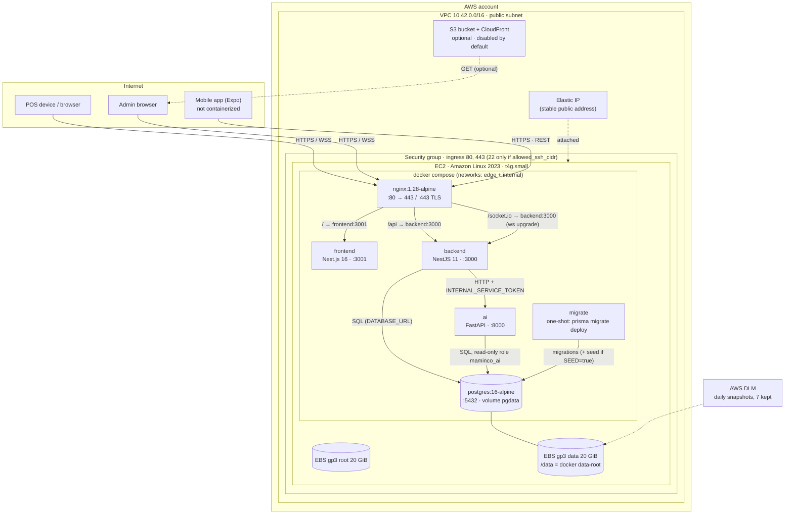

# Architecture

Maminco runs as a **single-host Docker Compose stack** on a small EC2 instance.
nginx is the only entrypoint of the host (TLS on 443, redirect from 80). With `enable_cdn_and_dns`, Route 53 (`maminco.lat`) and CloudFront sit in front of it (origin `origin.<domain>`, secret `X-Origin-Verify`, 443 open only to CloudFront); see DEPLOYMENT.md §11. Containers
are split over two bridge networks: `edge` (nginx, frontend, backend) and
`internal` (postgres, ai, backend), which has **no route to the internet**.

## Deployment diagram

## Request routing

| Incoming | nginx rule | Upstream | Notes |
| -------- | ---------- | -------- | ----- |
| `/` | `location /` | `frontend:3001` | SSR pages + middleware |
| `/_next/static/*` | static block | `frontend:3001` | HTTP/1.1, `Cache-Control: immutable` set by nginx (no proxy cache) |
| `/api/auth/*` | `location /api/auth/` | `backend:3000` | `limit_req` 5 r/s (burst 10) per IP |
| `/api/*` | `location /api/` | `backend:3000` | 30 r/s (burst 60); prefix preserved |
| `/socket.io/*` | WS block | `backend:3000` | `Upgrade`/`Connection` headers, buffering off |
| `/healthz` | exact match | nginx itself | `200 ok` for probes (also on port 80 in TLS mode) |
| `:80` anything else | TLS site only | — | `301` to `https://`; `/.well-known/acme-challenge/` served for certbot |

nginx configuration is split: `nginx/conf.d/00-common.conf` (upstreams, rate
zones, `server_tokens off`, gzip), `nginx/snippets/` (locations, security
headers, proxy headers) and `nginx/templates/{https,http}.conf.template`
(site, rendered by the nginx image with `DOMAIN`). The TLS site is the default;
`docker-compose.dev.yml` swaps in the HTTP-only site.

## Container responsibilities

- **nginx** — TLS termination (TLS 1.2/1.3, HSTS), security headers, rate
  limiting, gzip, body size limit, WebSocket upgrade, only public ports.
- **frontend** — Next.js `output: 'standalone'` Node server (`node server.js`).
  Required because `proxy.ts` guards admin/POS routes; a static export would
  break auth redirects.
- **migrate** — one-shot job (`restart: "no"`): `prisma migrate deploy`, and
  `prisma db seed` only when `SEED=true`. The backend waits for
  `service_completed_successfully`.
- **backend** — REST API under `/api`, JWT auth + role guards, socket.io
  gateways for orders/payments, calls the AI service. Prod dependencies only.
- **ai** — FastAPI forecasting/ML service; shares the Postgres instance; called
  only by the backend using a shared service token.
- **postgres** — single database, persisted in the `pgdata` volume, which lives
  on the separate data EBS volume (Docker `data-root` = `/data/docker`).
  First-init script `docker/postgres/10-ai-readonly.sh` creates the SELECT-only
  `maminco_ai` role used by the AI service.

## Network & security

- Only nginx publishes ports (`80`, `443`). Application ports are not published.
- `internal` network is `internal: true`: postgres and ai cannot reach the
  internet. backend and frontend sit on `edge` as well (the frontend's Next
  route handlers call `NEXT_PUBLIC_API_URL` server-side).
- Every container: `init: true` (plus `tini` in the images), `no-new-privileges`,
  `cap_drop: [ALL]` (postgres and nginx add back only the few capabilities
  their entrypoints need), `pids_limit`, memory limit, log rotation.
- Images run as non-root (`node`, `appuser`; postgres/nginx drop privileges).
- Secrets have no defaults in compose (`${VAR:?...}`); the AI service also
  refuses to boot with a missing/short/placeholder token.
- The security group opens `80`, `443`, and `22` only when `allowed_ssh_cidr`
  is set. IMDSv2 is required (hop limit 1, so containers cannot reach IMDS).
- No NAT gateway / private subnets — the instance sits in a public subnet with
  an Internet Gateway (cheapest possible topology).
- AWS SSM Session Manager is enabled via an instance profile: shell without an
  SSH key.

## Memory budget (t4g.small, 2 GiB)

| Container | Limit | Notes |
| --------- | ----- | ----- |
| postgres | 384 MiB | `shared_buffers=96MB`, `max_connections=40` |
| backend | 384 MiB | `--max-old-space-size=256` |
| ai | 448 MiB | pandas + scikit-learn, models fitted at start |
| frontend | 256 MiB | `--max-old-space-size=192` |
| nginx | 64 MiB | |
| **Sum** | **~1.5 GiB** | rest: OS + Docker; 1 GiB swap file created at first boot |

The one-shot `migrate` job (512 MiB limit) only runs before the backend starts.
Do not add services without re-checking this budget.

## Backups

AWS Data Lifecycle Manager snapshots the data volume (tag `Backup=daily`) every
24 h and keeps `backup_retention_days` (default 7). Snapshots are
crash-consistent: Postgres replays its WAL on restore. For a logical backup
before risky changes use `pg_dump` (see DEPLOYMENT.md).

## Scaling notes (out of scope, cheap-first)

- Vertical only on a single host. `t4g.small` comfortably runs all containers
  for a single restaurant.
- If load grows, the natural next steps are: move Postgres to RDS, add an ALB
  with two app instances, and serve the frontend from CloudFront — all omitted
  here on purpose to keep cost near zero.
