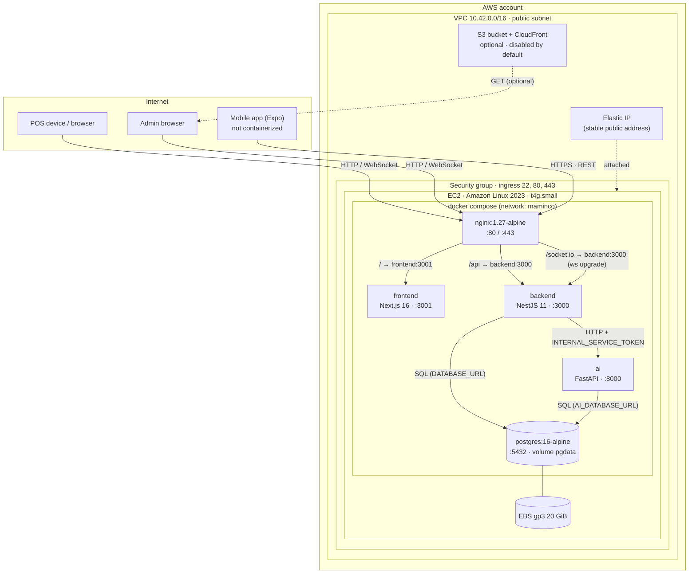

# Architecture

Maminco runs as a **single-host Docker Compose stack** on a small EC2 instance.
nginx is the only public entrypoint; all application containers live on a
private bridge network and are reached by service name.

## Deployment diagram

## Request routing

| Incoming | nginx rule | Upstream | Notes |
| -------- | ---------- | -------- | ----- |
| `/` | `location /` | `frontend:3001` | SSR pages + middleware |
| `/_next/static/*` | static cache block | `frontend:3001` | immutable, 30d |
| `/api/*` | `location /api/` | `backend:3000` | prefix preserved (no trailing slash on `proxy_pass`) |
| `/socket.io/*` | WS block | `backend:3000` | `Upgrade`/`Connection` headers, buffering off |
| `/healthz` | exact match | nginx itself | `200 ok` for probes |

## Container responsibilities

- **nginx** — TLS termination (when configured), gzip, body size limit,
  WebSocket upgrade, single public port.
- **frontend** — Next.js Node server. Required because `middleware.ts` guards
  admin/POS routes; a static export would break auth redirects.
- **backend** — REST API under `/api`, JWT auth + role guards, socket.io
  gateways for orders/payments, calls the AI service.
- **ai** — FastAPI forecasting/ML service; shares the Postgres instance; called
  only by the backend using a shared service token.
- **postgres** — single database, persisted in the `pgdata` volume.

## Network & security

- Only nginx publishes ports (`80`, optional `443`). Application ports are
  internal to the `maminco` bridge network.
- The security group opens `22` (restricted CIDR), `80`, `443`.
- No NAT gateway / private subnets — the instance sits in a public subnet with
  an Internet Gateway (cheapest possible topology).
- AWS SSM Session Manager is enabled via an instance profile, so you can get a
  shell without an SSH key.

## Scaling notes (out of scope, cheap-first)

- Vertical only on a single host. `t4g.small` comfortably runs all containers
  for a single restaurant.
- If load grows, the natural next steps are: move Postgres to RDS, add an ALB
  with two app instances, and serve the frontend from CloudFront — all omitted
  here on purpose to keep cost near zero.
