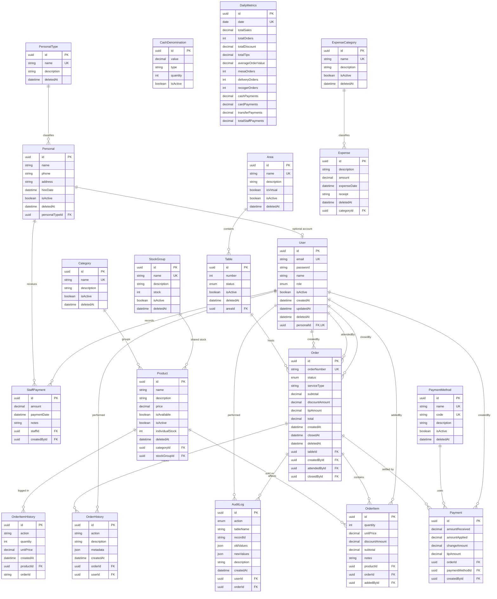

# Data model

Derived from `maminco-backend/prisma/schema.prisma` (PostgreSQL). All ids are
UUID strings unless noted. Money is `Decimal(10,2)` in **Bolivianos (Bs)**.
Most core tables support soft deletes via `deletedAt`.

## ER diagram

## Enums

| Enum | Values |
| ---- | ------ |
| `UserRole` | `ADMINISTRATOR`, `MANAGER`, `CASHIER`, `WAITER` |
| `OrderStatus` | `DRAFT`, `CLOSED`, `CANCELLED` |
| `TableStatus` | `AVAILABLE`, `OCCUPIED`, `RESERVED` |
| `AuditAction` | `CREATE`, `UPDATE`, `DELETE`, `PAYMENT`, `CLOSE_ORDER`, `CANCEL_ORDER` |

## Table notes

- **`users`** — auth identity. `personalId` optionally links a system user to a
  staff record. Role drives the backend's `@Roles(...)` guards.
- **`personal` / `personal_types`** — HR records; `personal_types` are
  customizable (CASHIER, WAITER, COCINERO…). **`staff_payments`** records wages
  paid, with the paying user for audit.
- **`categories`, `stock_groups`, `products`** — menu catalog. A product belongs
  to one category, and *optionally* to a stock group (shared inventory) or has
  its own `individualStock`.
- **`areas` / `tables`** — `areas` may be virtual (DELIVERY, RECOGER), in which
  case tables can have `number = 0`. `Table` is unique per `(areaId, number)`.
- **`orders`** — the sale header. `serviceType` mirrors the area name. Amounts:
  `total = subtotal - discountAmount + tipAmount`. Three user references track
  who created / attended / closed it.
- **`order_items`** — line items, `subtotal = quantity * unitPrice - discountAmount`,
  plus free-text `notes` (e.g. "sin cebolla") and `addedById` for audit.
  Cascade-deleted with the order.
- **`payments`** — one order can have several payments (split payments).
  `amountReceived`, `amountApplied`, optional `changeAmount` (cash only) and
  `tipAmount`.
- **`payment_methods`** — seeded as EFECTIVO/CASH, TRANSFERENCIA/TRANSFER,
  TARJETA/CARD (see `prisma/seed.ts`).
- **`cash_denominations`** — Boliviano coins/bills (1,2,5,10 coins; 20,50,100,200
  bills), unique per `(value, type)`, with a running `quantity` for the drawer.
- **`audit_logs`** — generic JSON before/after snapshots keyed by
  `(tableName, recordId)`, optionally linked to an order.
- **`order_histories` / `order_item_histories`** — human-readable change logs
  for an order and its items.
- **`daily_metrics`** — pre-aggregated BI rollup, one row per `date` (unique).
- **`expenses` / `expense_categories`** — operating expenses with an optional
  receipt reference.

## Indexes (highlights)

`orders(status, tableId, createdById, attendedById, closedById, createdAt, serviceType)`,
`products(categoryId, stockGroupId, isAvailable)`, `payments(orderId)`,
`tables(status)`, `audit_logs(userId, orderId, [tableName, recordId], createdAt)`.

## Schema lifecycle

There are **no committed Prisma migrations** yet. Deployments apply the schema
with `npx prisma db push` (see `docker-compose.yml`), then run the idempotent
`npx prisma db seed`. If migrations are added later, switch the backend boot
command to `npx prisma migrate deploy`.
