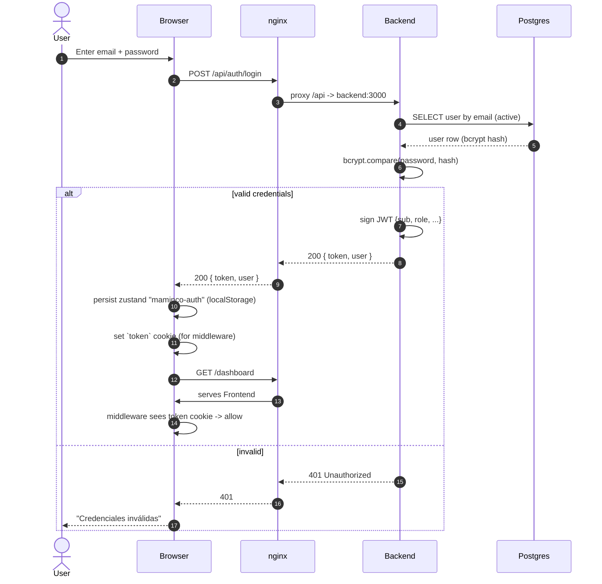
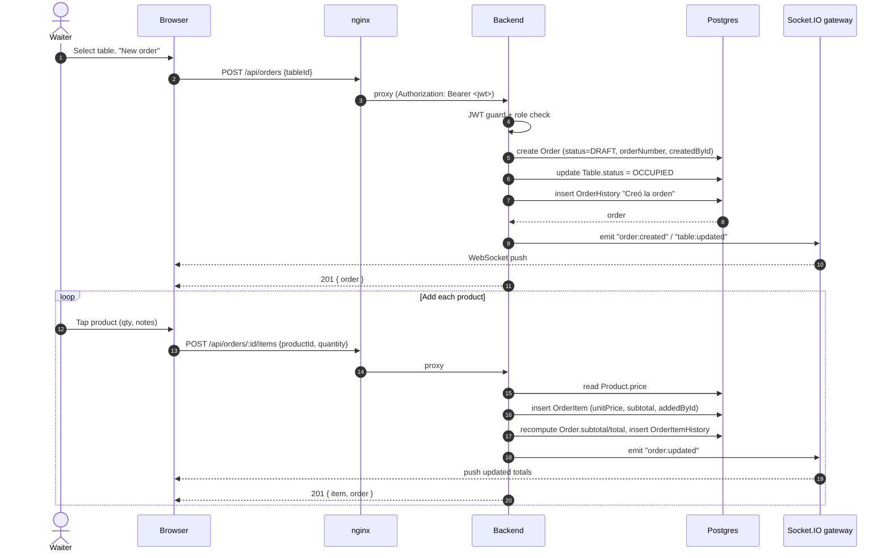
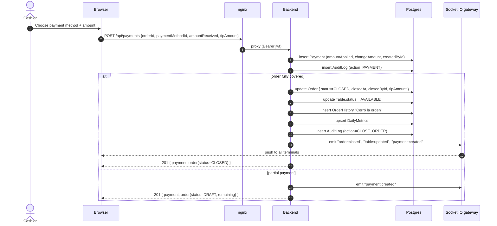
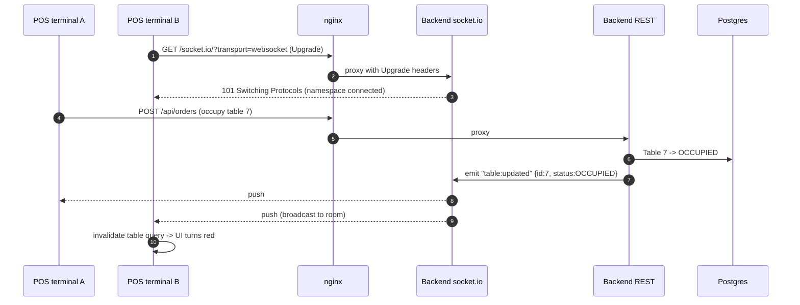
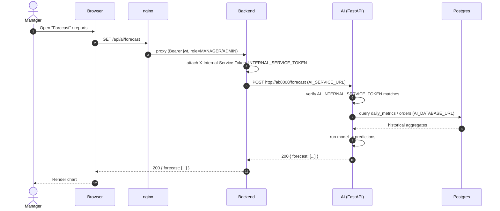

# Flows

End-to-end sequence diagrams for the main Maminco interactions. Socket event
names are illustrative — check `maminco-backend/src/orders/orders.gateway.ts`
and `.../payments/payments.gateway.ts` for the exact strings.

Participants:

- **Browser** — POS terminal or admin UI (React client)
- **nginx** — reverse proxy, TLS on 443 (HTTP only in dev)
- **Frontend** — Next.js server (SSR + `proxy.ts`)
- **Backend** — NestJS API (`/api/*`) + socket.io gateway
- **Postgres** — single database
- **AI** — FastAPI forecasting service

---

## 1. Login

Protected navigations (admin + POS prefixes) are guarded by `proxy.ts`,
which reads the `token` cookie and redirects to `/auth/login?from=...` when it
is missing. Authorization by role is enforced server-side with `@Roles(...)`.

---

## 2. Create order + add items

All monetary values are snapshotted at sale time (`unitPrice`), and
`subtotal = quantity * unitPrice - discountAmount`. The order remains `DRAFT`
until payment closes it.

---

## 3. Payment + close order

Split payments are supported: multiple `Payment` rows per order until the total
is covered. Cash change is only computed for the cash method.

---

## 4. Realtime table updates

nginx must forward the WebSocket upgrade for `/socket.io/` (see
`nginx/default.conf`); the frontend subscribes via
`lib/utils/socket.ts` / `hooks/useOrderSocket.ts` using `NEXT_PUBLIC_SOCKET_URL`.

---

## 5. Forecast request (backend → AI)

The backend and AI must share the **same** secret: backend
`INTERNAL_SERVICE_TOKEN` **==** ai `AI_INTERNAL_SERVICE_TOKEN`. The AI service
reads the same Postgres database through `AI_DATABASE_URL`.
